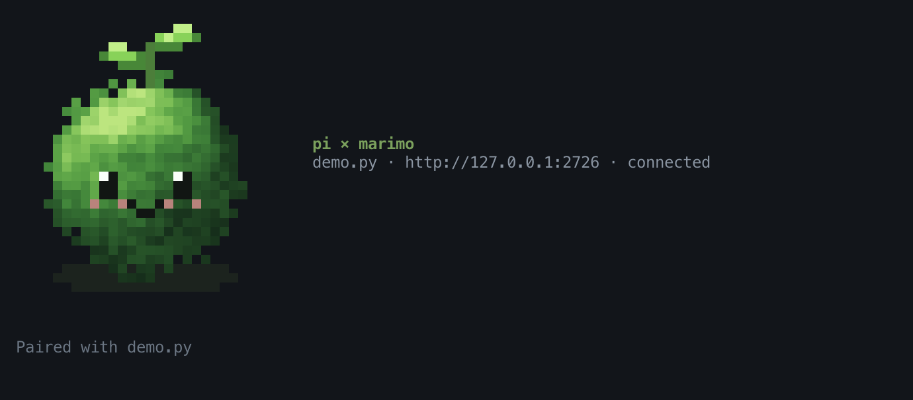

# pi-marimo

Pair the [pi](https://pi.dev) coding agent with a live [marimo](https://marimo.io) notebook. pi edits and runs cells in the notebook open in your browser, so you watch it work.



## Install

You need [uv](https://docs.astral.sh/uv/). marimo itself runs through `uvx marimo@latest`.

```bash
pi install git:github.com/koaning/pi-marimo
```

## Use

```bash
pi --marimo analysis.py
```

This opens the notebook in your browser (creating it if needed) and pairs pi with it. If the notebook is already running, pi reuses it. Servers pi started stop when you quit pi.

| Command | What it does |
| --- | --- |
| `/marimo` | Show the paired notebook and connection state |
| `/marimo file.py` | Open and pair with another notebook |
| `/marimo open` | Reopen the notebook in the browser, or restart it if it stopped |
| `/marimo list` | Pick a running notebook to pair with |
| `/marimo disconnect` | Unpair; the notebook keeps running |
| `/marimo stop` | Stop the server pi started, and unpair |

The agent gets `marimo_start`, `marimo_list`, `marimo_connect` and `marimo_execute`. The last one runs Python in the notebook's kernel and edits cells through marimo's code mode.

While paired, marimo shows a **pi connected** pill. Clicking Disconnect there unpairs pi.

**No browser?** A notebook is only pairable once it is open in a browser. Over SSH or in a container, pi prints the login URL while it waits, so you can open it yourself.

**Project environment:** notebooks run with `--sandbox` by default. Set `PI_MARIMO_SANDBOX=0` to use the current environment instead, e.g. `PI_MARIMO_SANDBOX=0 uv run pi --marimo analysis.py`.

## Develop

```bash
npm install
make check   # typecheck + tests
make dev     # pi with only this folder's pi-marimo loaded (NOTEBOOK=other.py to pick one)
```

`extensions/` holds the pi entry point and header; `src/` holds the marimo helpers, process management and the event stream behind the "pi connected" pill. pi provides `@earendil-works/*` and `typebox` at runtime, so keep them in `peerDependencies`, never `dependencies`.
